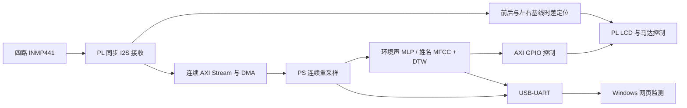

# 智耳传声：听障声向护航终端

**2026 年全国大学生嵌入式芯片与系统设计竞赛 · FPGA 创新设计赛道 · AMD 自主选题初级组**

基于 **ALINX AX7021（AMD Zynq-7000，XC7Z020-2CLG484I）** 的听障辅助原型。系统利用四路数字麦克风同步采集环境声音，在板端进行声源方位估计、环境声分类和姓名呼叫匹配，通过 LCD 图文与振动提醒使用者，并通过 Windows 本地网页展示实时波形。

本 README 面向评审与复现者，说明项目原理、工程组织、环境配置、源码构建、上板操作和验证方法。可先运行随包固件，再从源码构建；**使用现有功能不需要先重新训练模型**。

## 1. 项目简介

### 1.1 应用背景与功能

听障人士在校园、宿舍和日常活动中，可能难以及时察觉鸣笛、警报或他人呼唤。本项目将声音转化为方位、类别图标和触觉提示，探索在单块 Zynq SoC 上实现声音感知与辅助提醒的软硬件协同方法。当前实物由开发板、定制麦克风 PCB、LCD 和振动模块组成。

| 功能 | 实现内容 | 可观察的结果 |
|---|---|---|
| 声源方位提示 | 四麦同步采样，利用前后、左右两条相对基线的时差估计方位 | 屏幕方向提示及对应马达响应；无可靠估计时显示未定位状态 |
| 环境声识别 | PS 运行九类 MLP，包含八类目标声音与背景声 | 屏幕类别图标，串口与网页分类结果 |
| 网页波形监测 | 接收板端 CH0 展示波形，在电脑端进行显示滤波 | 接收波形、滤波后波形、幅度统计及连接状态 |
| 姓名呼叫提醒 | KEY1 启动模板录入，MFCC + DTW 匹配目标姓名 | 屏幕引导录入、LISTEN 监听，命中时 CALL YOU 与振动 |

环境声类别如下，训练、PS 输出和 PL 图标的编号必须一致：

| 编号 | 标签 | 中文含义 |
|---:|---|---|
| 0 | `background` | 背景声 |
| 1 | `bicycle_bell` | 自行车铃 |
| 2 | `car_horn` | 汽车鸣笛 |
| 3 | `construction_tool` | 施工与工具声 |
| 4 | `dog_bark` | 犬吠 |
| 5 | `human_shout` | 人声呼喊 |
| 6 | `impact_emergency` | 碰撞与突发冲击声 |
| 7 | `road_vehicle` | 道路车辆声 |
| 8 | `siren_alarm` | 警笛与报警声 |

### 1.2 系统原理与软硬件分工



- **PL**：产生麦克风时钟，同步接收四路 I2S，完成方位估计、连续音频组包、LCD 显示和马达控制。
- **PS Cortex-A9**：以 standalone 裸机运行，管理 DMA 双缓冲及缓存一致性，将四路音频分别连续重采样到 16 kHz，执行环境声识别或姓名模板流程，并处理按键与串口交互。
- **电脑端**：离线训练和模型导出，以及串口接收、网页显示与显示滤波。运行随包固件时，分类和姓名匹配均在板端完成。

工程采用 **Vivado RTL + Vitis PS 软件** 完成四路同步采集、连续数据传输与视觉/触觉提醒，并提供独立的 **PYNQ Stream Validation Skill**：以接口契约组织 Overlay 预检、DMA 调用、黄金参考与资源时序报告，支持向其他流式 FPGA 题目复用。

## 2. 仓库结构与材料索引

目录对应《2026 FPGA 赛道选题指南（AMD）》第 3.3.5.4 节推荐结构，其中 `src/` 按硬件、嵌入式软件、网页及训练细分。

```text
zhi_er_sound_assist/
|-- README.md
|-- src/
|   |-- vivado/test/              # test.xpr、RTL、XDC、Block Design
|   |-- vitis/audio_ps_ws/        # 平台、BSP 配置与 hearing_mlp 应用
|   |-- web/                     # 网页、串口服务、协议与滤波
|   `-- training/                # 训练、特征重建及依赖
|-- sim/                         # 验证脚本、参考结果和执行记录
|-- build/                       # 构建/模型导出脚本、综合与实现报告
|-- board/
|   |-- artifacts/               # 配套 BIT、XSA、ELF 与初始化文件
|   |-- hardware/                # 接线表、原理图和 PCB PDF
|   |-- evidence/                # 上板演示视频与截图
|   `-- run_jtag.tcl             # JTAG 运行入口
|-- data/                        # 模型、训练特征、清单和测试模板
|-- skill/                       # 通用 PYNQ 契约、DMA、参考比对与排错技能
|-- report/                      # 实现说明、设计资料与协作记录
`-- release_manifest.json        # 发布文件大小及 SHA-256 清单
```

| 阅读目的 | 入口 |
|---|---|
| 当前实现、关键参数和报告差异 | [当前实现说明](report/current_implementation.md) |
| 接线与硬件资料 | [接线表](board/hardware/wiring.md)、[原理图](board/hardware/schematic.pdf)、[PCB](board/hardware/pcb.pdf) |
| JTAG / Vitis 下载 | [上板说明](board/README.md) |
| 实测与参考对照、原始数据采集 | [材料索引](board/validation/README.md)、[视频比对报告](board/validation/comparison_report.md) |
| 实物演示及结果 | [演示视频](board/evidence/onboard_demo.mp4)、[时间点与截图索引](report/onboard_test_record.md) |
| 资源、时序及构建日志 | [构建报告](build/reports/) |
| 验证方法与执行结果 | [验证脚本](sim/)、[执行记录](sim/results/) |
| 通用 PYNQ 工具及工程经验 | [技能包](skill/README.md)、[独立工具入口](skill/pynq-stream-validation/README.md) |
| 四类 PYNQ 示例与跨题目迁移 | [对应关系与适用场景](skill/pynq-stream-validation/references/competition_mapping.md) |
| 大模型协作与第三方来源 | [协作记录](report/llm_collaboration.md)、[第三方许可](report/third_party_notices.md) |

工程输入集中在仓库内，不需要开发者电脑上的旧补丁目录。工具文件保留 `test.xpr`、`CMakeLists.txt`、`UserConfig.cmake` 等原名称；中文说明写在文件正文中。

## 3. 复现环境与准备

### 3.1 硬件

| 硬件 | 配置与用途 |
|---|---|
| 主控板 | ALINX AX7021，XC7Z020-2CLG484I，PL 主时钟 50 MHz |
| 麦克风 | 四个 INMP441，3.3 V，独立 SD，共用 SCK / WS |
| 阵列 | 10 × 10 cm 固定 PCB，前后、左右中心间距均为 60 mm |
| 显示屏 | ST7789V，240 × 320，SPI，3.3 V 逻辑 |
| 触觉输出 | YYNMOS-4 四路驱动器与四个振动马达，负载电源按实物额定值配置 |
| 操作按键 | 板载 KEY1，PS MIO11，低电平有效 |
| 调试连接 | JTAG 数据线、USB-UART 数据线、板卡电源 |
| 测试声源 | 语音或声音播放设备 |

前方麦克风靠近 AX7021，后方靠近 LCD。当前映射为 FRONT=J15-7/Y19、LEFT=J15-9/J21、RIGHT=J15-13/P16、BACK=J15-11/K21。原 PCB 图中右、后存在历史标注互换，以 [接线表](board/hardware/wiring.md) 和工程 XDC 为准。

四个麦克风 L/R 均接地，表示接收 I2S 左槽，与物理方位无关。外设逻辑为 3.3 V，J15-2 的 5 V 不可接入这些信号。马达必须经驱动器连接，不能由 FPGA IO 直接供电。LCD 触摸功能在本版本未启用。

### 3.2 软件

| 软件 | 版本 / 设置 | 使用环节 |
|---|---|---|
| 操作系统 | Windows 11 | 已使用的开发与上位机环境 |
| Vivado | 2026.1，含 Zynq-7000 器件支持及线缆驱动 | PL 构建和硬件导出 |
| Vitis Unified IDE / XSDB | 2026.1 | PS 构建、JTAG 下载与调试 |
| USB 串口驱动 | Silicon Labs CP210x，设备为 CP2102N | UART1 通信 |
| UART 参数 | 115200 baud，8 数据位，无校验，1 停止位 | 串口与网页 |
| Python | 3.10 | 检查、网页和训练 |
| 浏览器 | 支持现代 JavaScript 的浏览器 | 访问本地网页 |

训练依赖见 [src/training/requirements.txt](src/training/requirements.txt)，网页依赖见 [src/web/requirements.txt](src/web/requirements.txt)。两者分别建立虚拟环境。JTAG 运行现有固件本身不需要训练环境。

### 3.3 路径与完整性检查

推荐解压到英文短路径。以下以 `D:\ze` 为根目录，**全部命令从仓库根目录执行**；实际使用其他目录时，只替换第一条命令的路径。

```powershell
Set-Location D:\ze
py -3.10 --version
py -3.10 sim/check_package.py
```

预期：`external_references=0`，`xsa_bit_init_match=true`，`frozen_model_match=true`，`manifest_files_checked` 大于 0，进程正常退出。该检查确认工程引用与发布文件配套关系，不替代硬件测试。

若 Python 没有版本输出或指向 WindowsApps 占位程序，先安装真实 Python 3.10。自行修改文件后可加 `--skip-manifest` 跳过发布哈希检查，但仍检查冻结模型及 BIT / XSA / 初始化配套关系；发布新版本时需更新清单。

## 4. 快速运行随包固件

`board/artifacts/` 提供一套配套文件：`design_1_wrapper.bit`（PL）、`audio_platform.xsa`（硬件平台）、`ps7_init.tcl`（PS / DDR 初始化）、`hearing_mlp.elf`（PS 应用）及备用启动组件 `fsbl.elf`。

### 4.1 JTAG 下载

1. 断电核对接线，连接麦克风、LCD 和马达驱动。
2. 连接板卡电源、JTAG 和 USB-UART。按 AX7021 手册设置调试所需启动方式，随后上电。
3. 在设备管理器“端口（COM 和 LPT）”中确认 CP2102N 的 COM 号。若设备在“其他设备”下且带感叹号，先安装驱动。
4. 打开已加载 Vitis 2026.1 环境的终端，切换到仓库根目录，执行：

```powershell
xsdb board/run_jtag.tcl
```

脚本依次复位系统、加载 BIT、执行 `ps7_init` / `ps7_post_config`、下载 ELF 并启动 Cortex-A9 #0。出现 `Application running. UART1: 115200, 8N1.` 表示脚本已执行到启动步骤。

本版本使用 JTAG 运行，未提供 SD / Flash 自启动镜像，断电后需重新下载。

### 4.2 Vitis 图形界面下载（备选）

在应用的 Debug / Launch Configuration 中设置：

1. `Target Connection=Local`，`Target Setup Mode=Baremetal Debug`。
2. 选择检测到的 Zynq，应用处理器为 `ps7_cortexa9_0`。
3. `Bitstream File` 选择 `board/artifacts/design_1_wrapper.bit`。
4. 初始化方式选择 `TCL`，文件选择 `board/artifacts/ps7_init.tcl`。
5. 勾选 `Run ps7_init`、`Run Ps7 Post Init`、`Reset Entire System` 和 `Program Device`。
6. ELF 选择 `board/artifacts/hearing_mlp.elf`，启动 Debug。若停在 `main`，点击 `Continue`。

### 4.3 启动现象与串口

正常启动的文字输出包含：

```text
AX7021 FOUR FUNCTIONS: MLP + experimental MFCC/DTW NAME, HW36
...
Ready. Warming up...
```

LCD 出现运行界面。预热后，分类状态变化时输出 `Sound: background`、`Sound: dog_bark` 等，不会反复打印同一类别。

UART 同时承载文字与二进制波形，正常使用时由网页服务解析。临时用串口助手查看纯文字或发送显示命令时，先断开网页串口连接，按 115200 / 8N1 打开端口，发送 `WAVE:OFF` 加换行；完成后发送 `WAVE:ON` 加换行，关闭串口助手，再连接网页。同一 COM 不能由两者同时占用。

## 5. 功能操作与上板验证

### 5.1 方位提示

1. 在普通功能模式，向阵列前、左、右、后分别播放同一段声音，保持声源高度、音量和距离尽量一致。
2. 观察屏幕方向与马达响应，核对物理方位和接线关系。
3. 将声源移到相邻方向之间，检查斜向提示。没有可靠估计时允许显示未定位状态。
4. 每次只改变一个条件，再测试不同距离或音量，使用 [测试记录模板](data/onboard_test_template.csv) 保存条件与结果。

LCD 方向页可通过串口命令 `VIEW:DIR` 加换行选取。振动由板端直接控制。

### 5.2 环境声识别

1. 保持非姓名模式，依次播放犬吠、鸣笛、自行车铃等音频。
2. 发送 `VIEW:ICON` 加换行，选择 LCD 类别图标页；发送 `VIEW:DIR` 返回方向页。
3. 查看图标与 `Sound: <label>` 输出。停止播放后观察是否回到背景状态。
4. 每类使用多段独立音频，记录输入标签、输出类别与播放条件，避免仅凭单段音频判断总体效果。

模型窗口为 2 秒、更新步长为 0.25 秒，并包含平滑、确认与释放处理。这些配置不等同于实测端到端提醒延迟。

### 5.3 网页波形与显示滤波

在普通 PowerShell 中执行：

```powershell
py -3.10 -m venv .venv_web
.\.venv_web\Scripts\python.exe -m pip install -r src/web/requirements.txt
.\.venv_web\Scripts\python.exe src/web/server.py
```

后续启动仅需最后一条命令。

1. 浏览器打开 `http://127.0.0.1:8765`。
2. 刷新串口列表，选择 CP2102N 对应的 COM、波特率 `115200`，点击“连接”。
3. 正常接收时，波形、采样率和幅度统计持续更新；发声后波形应相应变化。
4. 调整高通、低通或工频抑制，点击“应用滤波”，对比接收波形与处理后波形。
5. 可暂停显示、清空或导出当前窗口的对比 WAV。

当前固件仅传输**前方 CH0、4 kHz 展示波形**，四路分类与定位仍在板端运行。网页显示滤波不会改变板端分类输入。导出 WAV 的左声道是接收波形、右声道是网页滤波后波形，不是物理左右麦克风，也不能替代 16 kHz 分类输入进行模型一致性比较。

### 5.4 KEY1 录入姓名与呼叫提醒

此功能直接录入声音模板，无需串口输入名字文字。

1. 在相对安静的环境启动设备并松开 KEY1。短按后松开，可在普通功能与姓名模式间切换。
2. 长按 KEY1 约 **1.2 秒**启动整轮引导，然后松开，等待环境校准。
3. `SAY NAME 1/3` 时说一次目标姓名，说完保持安静，等待保存及下一步。`2/3`、`3/3` 仍说同一个姓名。
4. `SAY OTHER 1/3` 至 `3/3` 时，依次说其他姓名或不同短语，作为非目标示例，不要继续说目标姓名。
5. 录入与校准通过后进入 `LISTEN`。呼叫目标姓名，观察 `CALL YOU` 和振动提醒。
6. 等提示与冷却结束后，再说其他姓名观察误触发。需要重新录入时，再次长按 KEY1。

`SETUP STOPPED / HOLD KEY1 RETRY` 表示本轮未通过，松开按键、改善录音环境后重新长按。模板保存在 RAM，切换模式保留，断电、复位或重新运行应用后需要重新录入。

姓名是声学模板匹配，不是文字转写或说话人认证。命中后提示窗口约 2 秒、冷却约 3 秒；同一次提示窗口内的马达变化不应直接计为又命中一次。

## 6. 从源码构建

依赖顺序为 **Vivado 工程 → BIT / XSA → Vitis 平台与 BSP → 应用 ELF → 配套初始化后上板**。只修改同接口 PS 应用或模型参数，可保留硬件；修改 PL、地址映射、时钟或 PS 配置后，需重新导出 XSA 并更新 Vitis 平台。

### 6.1 PL 构建与硬件导出

在 Vivado 2026.1 命令环境中执行：

```powershell
vivado -mode batch -source build/rebuild_vivado.tcl
```

脚本打开 `src/vivado/test/test.xpr`，更新编译顺序，强制验证 Block Design，生成输出产物，执行综合、实现和 bitstream 导出。成功产物位于：

```text
build/output/vivado/
|-- design_1_wrapper.bit
|-- audio_platform.xsa
|-- utilization.rpt
|-- timing_summary.rpt
`-- drc.rpt
```

图形界面对应流程：

1. `Open Project` 打开 `src/vivado/test/test.xpr`，确认器件 `xc7z020clg484-2`、顶层 `design_1_wrapper`。
2. 打开 `design_1.bd`，有过期 Module Reference 时更新引用，`Validate Design` 通过后保存。
3. 右键 BD → `Generate Output Products`。需要 wrapper 时选择 `Create HDL Wrapper`，由 Vivado 管理并设为顶层。
4. 点击 `Generate Bitstream`，完成后查看资源、时序和 DRC。
5. `File → Export → Export Hardware`，选择包含 bitstream 的导出方式，生成 XSA。

工程包含运行所需 RTL、显示资源和约束，不能用单独的 `test.v` 或 `.xpr` 代替完整工程。

### 6.2 PS 平台与应用构建

**方式一：脚本建立新工作区。**在 Vitis 2026.1 命令环境执行：

```powershell
vitis -s build/rebuild_vitis.py
```

默认使用 `board/artifacts/audio_platform.xsa`，创建 `audio_platform`、`standalone_ps7_cortexa9_0` 域和 `hearing_mlp` 应用，编译仓库中的应用源码。工作区位于 `build/output/vitis_日期时间/`，ELF 为其中的 `hearing_mlp/build/hearing_mlp.elf`。

要配合 6.1 节新硬件构建，可将 `build/rebuild_vitis.py` 中 `--xsa` 的默认值从 `root/'board/artifacts/audio_platform.xsa'` 改为 `root/'build/output/vivado/audio_platform.xsa'`，再执行上述命令。脚本也接受 `--xsa` 参数，但外部启动器的参数传递需按本地 Vitis 的用法执行。

**方式二：使用仓库中的 Vitis 工作区。**先修复平台的本机路径：

```powershell
py -3.10 build/prepare_workspace.py
```

1. Vitis 打开 `src/vitis/audio_ps_ws` 工作区。
2. 打开 `audio_platform → Settings → vitis-comp.json`，点击 `Switch / re-read XSA`。
3. 选择 `board/artifacts/audio_platform.xsa`；若使用新硬件，则改选 6.1 节导出的 XSA。
4. 确认 CPU 为 `ps7_cortexa9_0`，OS 为 `standalone`，标准输入 / 输出为 `ps7_uart_1`。
5. 先 Build `audio_platform`，重新生成 BSP 与驱动，再 Build `hearing_mlp`。
6. 保留应用 `UserConfig.cmake` 的现有源文件列表、`-O2` 及数学库 `m`；不要覆盖为其他工程的配置。
7. 以 Build 日志 `Build Finished successfully` 和 ELF 为准。若只有编辑器红线而编译成功，刷新索引及编译配置。

### 6.3 下载新版本

新 BIT、ELF 与 PS 初始化必须来自同一硬件配置。对于 6.1 节输出，可从对应 XSA 提取初始化脚本：

```powershell
py -3.10 -c "from pathlib import Path; from zipfile import ZipFile; p=Path('build/output/vivado'); z=ZipFile(p/'audio_platform.xsa'); (p/'ps7_init.tcl').write_bytes(z.read('ps7_init.tcl'))"
```

按 4.2 节在 Vitis 中改选新 BIT、新 ELF 与新 `ps7_init.tcl` 下载。`run_jtag.tcl` 也支持三个参数，顺序为 **BIT、ELF、初始化 TCL**，需要一次指定完整配套文件。

下载后重新执行第 5 节。`board/artifacts/` 保留随包版本，新产物放在 `build/output/`，避免互相覆盖。

## 7. 模型训练、评估与部署

### 7.1 输入与配置

| 输入 / 配置 | 路径或取值 |
|---|---|
| 训练、验证与评估特征 | `data/training/features.joblib` |
| 录音清单 | `data/training/base_manifest.csv`、`negative_manifest.csv` |
| 初始化模型 | `data/models/initial_model.joblib` |
| 随包部署模型 | `data/models/latest_model.joblib`、`latest_model.npz` |
| 特征与网络 | 16 kHz，2 秒窗口，160 维；160 → 128 → 64 → 9 |
| 类别顺序 | 第 1.1 节固定顺序 |

训练入口读取随包特征和初始化模型，复现再训练流程无需复制原始 WAV。该流程为基于初始化模型的受约束再训练 / 阈值校准，不是随机初始化训练。当前部署模型历史选中的候选为 `threshold_only`，沿用初始化模型权重、调整分类型阈值。

### 7.2 建立环境与训练

```powershell
py -3.10 -m venv .venv_train
.\.venv_train\Scripts\python.exe -m pip install -r src/training/requirements.txt
.\.venv_train\Scripts\python.exe src/training/train.py --check-only
.\.venv_train\Scripts\python.exe src/training/train.py
```

`--check-only` 检查输入、维度和数据划分，不训练。默认 `full` 比较权重调整候选及阈值候选，使用验证集选择方案，再输出评估结果。仅复现阈值校准时：

```powershell
.\.venv_train\Scripts\python.exe src/training/train.py --mode thresholds
```

每次运行输出到独立的 `build/output/train_日期时间/`：

```text
train_<timestamp>/
|-- models/fsd50k_danger_mlp.joblib
|-- models/fsd50k_danger_mlp.npz
|-- reports/focused_report.json
|-- reports/comparison.json
`-- run_config.json
```

以 `selected_candidate` 判断实际选中的方案。新运行不会自动覆盖部署模型，尚未上板的训练产物不作为新的上板结果。

### 7.3 原始音频重建特征（可选）

准备清单对应的 FSD50K 音频，根目录应包含 `FSD50K.dev_audio/` 和 `FSD50K.eval_audio/`。来源和许可见 [dataset_source.md](data/training/dataset_source.md) 与 [dataset_license.txt](data/training/dataset_license.txt)。

```powershell
.\.venv_train\Scripts\python.exe src/training/build_dataset.py --audio-root E:/FSD50K --check-only
.\.venv_train\Scripts\python.exe src/training/build_dataset.py --audio-root E:/FSD50K
.\.venv_train\Scripts\python.exe src/training/train.py --features data/training/features_rebuilt.joblib
```

默认特征产物为 `data/training/features_rebuilt.joblib`，已存在时需另选 `--output`。仓库不含原始 WAV。新增录音应同步更新标签与划分，避免同一源录音的片段跨入训练集和评估集。

### 7.4 导出 C 参数与部署

将 `train_YYYYMMDD_HHMMSS` 替换为实际训练目录：

```powershell
.\.venv_train\Scripts\python.exe build/export_model.py --model build/output/train_YYYYMMDD_HHMMSS/models/fsd50k_danger_mlp.npz --output build/output/exported_model
```

导出目录必须为空或不存在。导出器检查特征配置、网络维度、类别顺序和浮点有效性，生成 `model_data.c`、`model_data.h` 及 `export_manifest.json`。

1. 将生成的 C / H 文件替换到实际 Vitis 应用 `hearing_mlp/src/`。
2. 重新 Build 应用，下载新 ELF。
3. 重做分类与背景误触发测试，保存和原版本的比较结果。

同接口模型参数变化通常无需重建 Vivado。改变特征、类别数、图标编号、控制字或接口时，需要同步修改对应 PS / PL 逻辑。

## 8. 验证方法与已有结果

### 8.1 电脑侧检查

```powershell
py -3.10 sim/check_package.py
.\.venv_web\Scripts\python.exe sim/test_web_protocol.py
.\.venv_train\Scripts\python.exe build/export_model.py --output build/output/verify_model --verify-only
py -3.10 build/rebuild_vitis.py --check-only
python skill/pynq-stream-validation/tests/test_stream_skill.py --output sim/results/skill_tests.json
python sim/run_rtl.py --vivado-bin G:/vivado/2026.1/Vivado/bin
```

| 检查 | 通过判据 |
|---|---|
| 工程与发布文件 | 无外部或缺失 XPR 引用，BIT / XSA / 初始化配套，清单一致 |
| 网页协议 | 协议测试正常退出，分帧、分类文本解复用、CRC 等测试通过 |
| 模型常量 | `equal_to_frozen_model=true`，`different_arrays` 为空 |
| Vitis 构建输入 | XSA 存在，应用源码可收集，脚本正常退出 |
| PYNQ Skill 软件回归 | 契约、HWH、黄金参考、DMA 替身的正常/错误路径通过 |
| AXI Stream RTL 仿真 | 数据顺序、符号扩展、背压、TLAST、连续包、溢出/复位检查通过 |

`--verify-only` 仅比较随包 NPZ 与 C 常量；Vitis `--check-only` 只检查输入。Vivado 路径按本机安装位置替换。完整 C 数值/状态测试与 ARM 编译命令、测试结果和证据边界见 [验证说明](sim/README.md)；训练参考另见 [sim/training_reference/](sim/training_reference/)。

### 8.2 综合与实现

以下来自 `build/reports/` 的随包实现报告，重新构建后应以新报告为准：

| 指标 | 数值 |
|---|---:|
| 器件 | XC7Z020-2CLG484I |
| PL 主时钟 | 50 MHz，周期 20 ns |
| Slice LUTs | 8,419 / 53,200，15.83% |
| Slice Registers | 4,301 / 106,400，4.04% |
| Block RAM Tile | 26.5 / 140，18.93% |
| DSPs | 25 / 220，11.36% |
| WNS / TNS | 0.769 ns / 0.000 ns |

时序结论仅针对已设置约束，报告仍有 4 项输入、11 项输出 delay 缺失，工具估算功耗不作为实测功耗。解析结果含报告哈希，见 `sim/results/implementation_metrics.json`。本次新增 RTL 仿真与完整 PS 交叉编译记录见 `sim/README.md`；完整重新综合与板端验收按第 6 节执行。

### 8.3 实物演示与适用边界

[整机视频](board/evidence/onboard_demo.mp4) 展示方向变化、马达响应、网页波形、犬吠 / 车辆 / 车铃 / 鸣笛显示，以及姓名录入、监听和提醒。时间点与截图见 [onboard_test_record.md](report/onboard_test_record.md)。

这些记录证明相关功能链路已有实物演示。多说话人、多距离、混响与噪声条件下的定位准确率、分类召回率、姓名误报率、端到端延迟和长时稳定性尚无完整统计。复现时应记录条件和重复次数，独立测试音频与训练音频应分离。

## 9. 常见问题

| 现象 | 排查方式 |
|---|---|
| 找不到 COM | 核对 USB-UART 数据接口及数据线，安装 CP210x 驱动 |
| 网页串口连接失败 | 关闭其他串口占用者，核对 COM、115200 |
| 页面打开但无波形 | 检查真实串口连接、ELF 是否运行、波形传输是否开启 |
| LCD 有方向但 PS 无分类 | PL 与 PS 可独立运行，检查 ELF、初始化和 DMA 时钟复位 |
| `WRONG HARDWARE` 或采集失败 | 核对 HW36、四通道、12208 帧连续流与 BIT / XSA / ELF 配套，避免使用旧三麦或突发采集版本 |
| 右、后方向互换 | 核对 RIGHT=P16、BACK=K21 及阵列物理朝向 |
| 姓名录入停止或误触发 | 松开 KEY1、降低噪声，按屏幕逐次录入，目标与负例区别清楚，每次说完等待保存 |
| 更新模型后完整性检查失败 | 检查器针对冻结版本；确认新 NPZ、C 参数和实测记录一致后再更新版本基准及清单 |

## 10. 设计资料、技能包与许可

- [当前实现说明](report/current_implementation.md) 给出参数与接口。`report/technical_report_original.docx` 是历史设计稿，部分引脚与姓名流程已更新，阅读时以当前源码、约束和实现说明为准。
- [技能包](skill/README.md) 提供通用 PYNQ Overlay/DMA 调用、契约与代码生成、黄金参考和报告工具，以及提示词/排错流程；每项均列适用范围、方法、失效条件、已验证效果及经验来源。运行层次与实机验收见 [技能验证矩阵](skill/pynq-stream-validation/references/validation.md)。
- [大模型协作记录](report/llm_collaboration.md) 保存过程摘要，覆盖范围以文档说明为准。
- PYNQ Skill 子目录采用 [MIT](skill/pynq-stream-validation/LICENSE)。其他自编工程公开前仍需团队确认授权、统一开源协议与署名；第三方代码和数据保留原许可，见 [第三方许可说明](report/third_party_notices.md)。

更新模型、硬件或应用后，同步复现说明与测试记录，运行 `python build/update_manifest.py` 更新发布清单，再执行 `python sim/check_package.py`。正式报告、原始大模型聊天导出和公开前授权检查见 [验证与提交说明](sim/README.md)。
