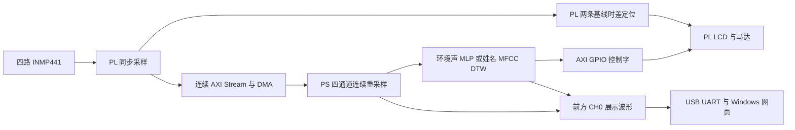

## 系统与完成状态

作品为 AX7021 + 四路 INMP441 固定阵列 + ST7789V 屏 + YYNMOS-4 及马达组成的原型。前方靠近主控、后方靠近屏幕，左右/前后基线按团队给定值均为 60 mm。PL 做同步 I2S 接收、定位、连续组包、LCD 与马达控制，PS Cortex-A9 裸机做连续重采样、环境声分类、姓名模板和交互；Windows 网页只负责监测和显示。

团队已提供约 2 分 58 秒的整机演示。视频涵盖启动、方向提示、网页波形、类别图标、按键姓名录入及监听提醒。

## 当前关键契约

| 项目 | 当前值 |
|---|---|
| 芯片 | XC7Z020-2CLG484I / Vivado part xc7z020clg484-2 |
| PL 主时钟 | 50 MHz，Y9 |
| 原始采样率 | 50 MHz / 16 / 64 = 48828.125 Hz |
| PCM | 四路，32 位容器中右对齐、符号扩展的 24 bit PCM |
| 通道顺序 | CH0 FRONT、CH1 LEFT、CH2 RIGHT、CH3 BACK |
| 右/后约束 | RIGHT=P16 / J15-13；BACK=K21 / J15-11 |
| DMA 包 | 12208 帧 × 4 通道 × 4 字节 = 195328 字节 |
| 硬件签名 | HW36，连续流|
| PS 模型采样率 | 16 kHz，连续有状态重采样 |
| 模型窗口/更新 | 32000 点 / 每 4000 点；16000 点起始预热 |
| 特征与网络 | 160 维，160→128→64→9 |
| 类别后处理 | RMS 0.0015、阈值比例 0.90、EMA 0.60、3 次中 2 次确认、4 次释放 |
| 网页通路 | CH0，16 kHz 经低通和 4 倍抽取得到 4 kHz；115200 / 8N1 |
| 姓名 | 3 正例 + 3 负例，MFCC + DTW，RAM 模板 |

主作品由 PS standalone 软件与 PL 协同运行；另提供独立的 PYNQ Stream Validation Skill，以契约组织 Overlay/DMA 接口、调用骨架、黄金参考和报告工具。工具复用范围与分层验证见 skill/README.md 和其中的验证矩阵。

## 上传工程原有实现报告

| 指标 | 报告值 |
|---|---:|
| Slice LUTs | 8419 / 53200，15.83% |
| Slice Registers | 4301 / 106400，4.04% |
| Block RAM Tile | 26.5 / 140，18.93% |
| DSPs | 25 / 220，11.36% |
| WNS / TNS | 0.769 ns / 0.000 ns |
| WHS / THS | 0.044 ns / 0.000 ns |
| 报告时序结论 | All user specified timing constraints are met |

## 模型与训练复现

本次部署 C 模型与 data/models/latest_model.npz 配套。已部署历史最优候选为 threshold_only，网络权重沿用此前训练模型、调整分类型阈值；最新 full 入口仍保留权重微调候选并按验证集选择。整理不重新训练或替换已部署模型。

本次额外提供 NPZ→C 导出器，限制相同特征配置、网络维度和类别顺序，并以冻结 C 模型做数值核对。

## 文档与源码来源

RTL、XDC、BD、PS 应用与网页有效代码来源文件夹；原图与原报告来自用户附件；训练来自本机已验证的 FSD50K_training_latest。此次新增通用 PYNQ 工具、RTL/PS 回归与验证说明，不替换冻结 BIT/XSA/ELF 或部署算法。source_inventory.json 记录原始来源映射，release_manifest.json 记录发布内容哈希。
