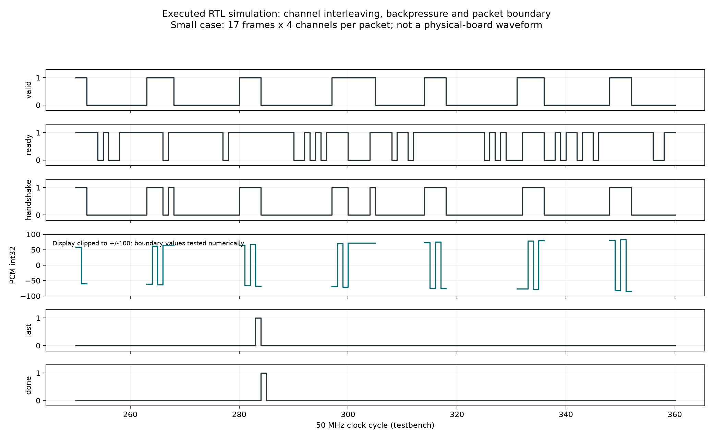

# 仿真、软件验证与实验结果

本目录将新执行的电脑验证、实现报告、历史训练和实物演示分别保存。结果来自真实命令输出。

## 新增验证与执行方法

从工程包根目录运行，Python 环境需 NumPy/SciPy。工具位置按本机替换。

~~~powershell
python skill/pynq-stream-validation/tests/test_stream_skill.py --output sim/results/skill_tests.json
python sim/run_rtl.py --vivado-bin G:/vivado/2026.1/Vivado/bin
python sim/plot_rtl_trace.py
python sim/test_ps.py --cc G:/vivado/2026.1/tps/mingw/10.0.0/win64.o/nt/bin/gcc.exe --arm G:/vivado/2026.1/gnu/aarch32/nt/gcc-arm-none-eabi/bin/arm-none-eabi-gcc.exe
python sim/test_web_protocol.py
python sim/run_software_checks.py
python build/export_model.py --output build/output/unused --verify-only
python build/rebuild_vitis.py --check-only
python build/update_manifest.py
python sim/check_package.py
~~~

| 项目 | 真实执行结果与判据 | 证据 |
|---|---|---|
| PYNQ 工具软件回归 | 13 组 unittest；两种非本题契约、HWH 正/反例、整数/浮点/非有限值、DMA 顺序/缓存/短包/错误/超时/停止失败、生成骨架 | results/skill_tests.json |
| 连续组包 RTL | 小包 17 帧×3 包，204 字；生产参数 12208 帧×2 包，97664 字；逐字验证通道/符号扩展，随机背压、全 TKEEP、TLAST/done、溢出粘滞与复位 | rtl/tb_packetizer.sv、results/rtl_summary.json、results/rtl_packetizer.log |
| 姓名界面 RTL | 11 个阶段×3 个模板序号非空/无未知像素、显示区域边界、alert 覆盖和 ready 回退 | rtl/tb_name_banner.sv、同一 RTL 日志 |
| 实际 C MFCC | 与独立 NumPy/SciPy 参考最大绝对误差约 4.977e-6，小于 0.002 | test_ps.py、results/ps_regression.json |
| 实际 C DTW | 与独立动态规划参考误差约 1.647e-8，小于 1e-4；相同特征距离为零 | 同上 |
| 实际 C 姓名状态 | 12 项断言：按键延后派发、引导、静音校准、三正三负、合成目标/负例、模式保留/清空、超时、过长、停止、非法输入 | 同上，含真实 C 日志 |
| 完整 PS 编译链接 | 原应用 13 个 C 文件，Cortex-A9 hard-float -O2，随包 BSP 与链接脚本，编译并链接 ELF；text 273027、data 2160、bss 3004592 字节 | results/ps_build.log、results/ps_regression.json |
| 模型参数一致性 | 9 个数组与冻结模型精确一致 | results/current_software_checks.json |
| 实际 XSA 元数据 | 从含 DMA 的主 HWH 检查简单模式、23位长度、32位流及配套 BIT/HWH 哈希，不执行下载 | results/current_software_checks.json |
| 网页协议 | 文本/PCM 分离、7字节碎片、CRC损坏恢复、四通道解析、显示DSP通过 | results/current_software_checks.json |
| 原实现报告解析 | LUT 8419、FF 4301、BRAM 26.5、DSP 25；WNS 0.769 ns、WHS 0.044 ns；保留4项input/11项output delay缺失 | results/implementation_metrics.json |

首次合成姓名测试的前导静音不一致触发校准拒绝；只统一输入、未修改实际算法，纠错记录在 results/ps_fixture_revision.md。

results/rtl_packetizer_trace.csv 保存真实仿真前499拍的 valid/ready/data/TLAST/done/overflow，便于重新绘制波形或与日志核对；生产包长比对的完整计数在 rtl_summary.json。

图由 CSV 直接绘制，展示小包的背压与包边界。

## 原实物演示与历史结果

- 整机视频 board/evidence/onboard_demo.mp4；启动/方向与振动/网页/类别图标/姓名录入和目标及非目标示例，时间点见 report/onboard_test_record.md。
- 综合实现原始报告在 build/reports；完整重新生成硬件按根 README 第6节；没有同条件优化前基线，不提供虚构收益。
- training_reference 是历史离线评估。
- 旧 results/checks.json、source_and_artifacts 等是初次归档记录；本次增补看命名为 skill_tests、rtl_summary、ps_regression、current_software_checks 的文件，勿混淆执行范围。

## PYNQ 实机与统计验收

本次补充：board/validation/ 给出10条基于原始视频的参考行为/实测观察对照、来源哈希和限制；board/scripts/record_uart.py 提供后续真实串口原始字节采集。不将视频观察计为统计准确率。新增寄存器字段和性能工具的电脑回归可用
`python sim/test_submission_additions.py` 重跑，结果在 results/submission_additions.json。

技能包对应赛题四类示例的文件、命令，以及FIR、工业多通道采集、FFT、定长图像和向量算子等迁移场景，见 skill/pynq-stream-validation/references/competition_mapping.md。

技能包可离线运行契约/黄金参考/报告/生成器和软件回归。Overlay 下载、register_map、真实 DMA/缓存/吞吐、跨板复用导出，清单见 skill/pynq-stream-validation/references/validation.md。

